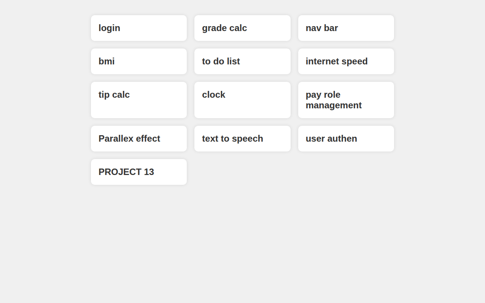

# Project Links Hub (12 Links)

A single-page hub that links out to a collection of mini-project demo sites.



## What it is

One page, one grid of links — a launchpad for a set of small web projects hosted on GitHub Pages, plus one auth app hosted on Render. Instead of remembering twelve different URLs, this page collects them all in one place.

## Links included

- Mini-project demos hosted on GitHub Pages (MYPROJECT1–MYPROJECT11, MYPROJECT13): login/signup page, grade calculator, scroll navbar demo, BMI calculator, task tracker, network speed test, tip calculator, analog clock, cash-change calculator, parallax demo, text-to-speech converter, and an AI image generator.
- An auth app hosted on Render.

## Tech Stack

- Plain HTML
- CSS (inline)

## How to Run

Just open the file in a browser — no install, no server needed:

```bash
# Option 1: open directly
open index.html

# Option 2: serve it locally
python3 -m http.server 8000
# then visit http://localhost:8000
```

## Notes

- The project links point to GitHub Pages sites, so they only work while those repos are published on Pages.
